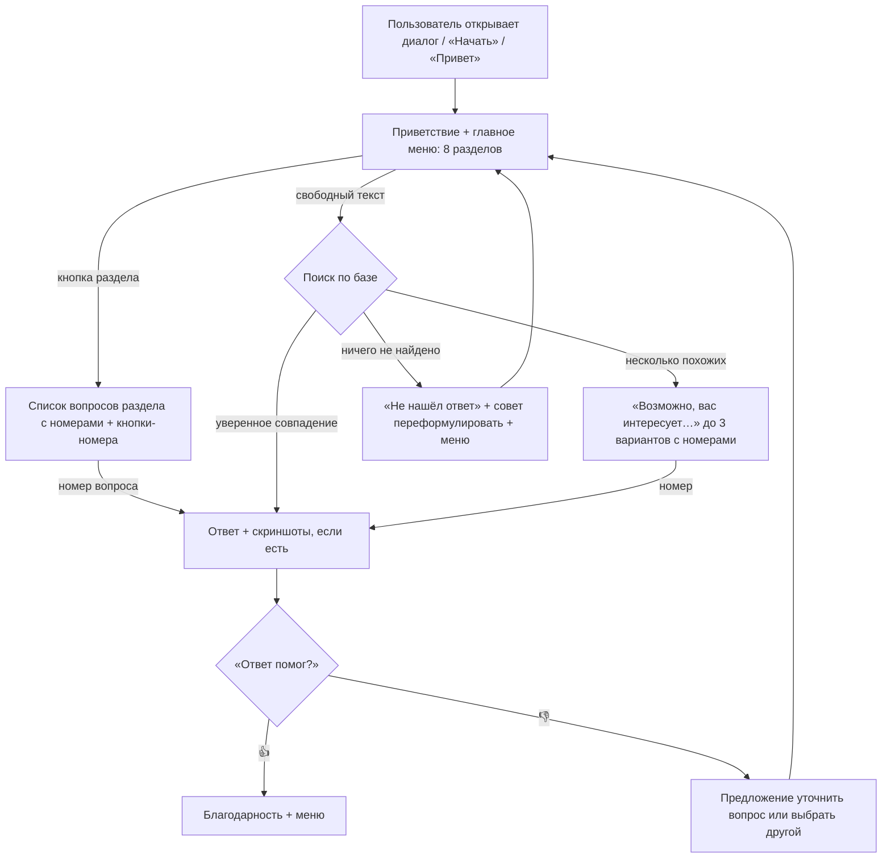

# Сценарий чат-бота ГУАП (ВКонтакте)

**Назначение.** Круглосуточно отвечать на частые вопросы воспитанников и выпускников из числа детей-сирот и детей, оставшихся без попечения родителей: документы, образование, жильё, здоровье, выплаты и льготы, трудоустройство, воинский учёт. Передачи живому специалисту нет: если ответа в базе нет, бот предлагает переформулировать вопрос или выбрать раздел.

**База знаний.** 91 вопрос в 8 разделах (файл `ГУАП_все_вопросы.docx` → `data/faq.json`), 11 ответов дополнены скриншотами (20 изображений).

| Раздел | Вопросы (№) |
|---|---|
| 📄 Документы | 1–8 |
| 🎓 Образование | 9–12 |
| 🏠 Жилье | 13–22 |
| 🏥 Здоровье | 23–39 |
| 💰 Пособия, выплаты, пенсии и льготы | 40–54 |
| 💼 Трудоустройство | 55–73 |
| 📌 Другое | 74–79 |
| 🎖 Воинский учёт | 80–91 |

---

## 1. Общая схема диалога

## 2. Экраны и тексты

| Экран | Что видит пользователь | Кнопки |
|---|---|---|
| **Приветствие** | Кто такой бот, как им пользоваться (кнопки или своими словами), просьба не присылать личные данные | 8 разделов |
| **Раздел** | Список вопросов раздела с номерами | Номера вопросов (по 5 в ряд), «🏠 Меню» |
| **Ответ** | Вопрос + текст ответа (длинные делятся на части ≤3500 символов) + скриншоты + «Ответ помог?» | «👍 Да», «👎 Нет», «◀ К разделу», «🏠 Меню» |
| **Уточнение** | До 3 похожих вопросов с номерами | Номера вопросов, «🏠 Меню» |
| **Не найдено** | Просьба переформулировать вопрос или выбрать раздел | Главное меню |

Все тексты находятся в файле `texts.py` и редактируются без знания программирования.

## 3. Правила обработки сообщений (по порядку)

1. **Нажатие кнопки** (payload) → выполняется команда кнопки.
2. **Кнопка «Начать»** или слова `привет`, `здравствуйте`, `меню`, `/start` → приветствие и главное меню.
3. **«Спасибо»** → короткая благодарность и меню.
4. **Число** (например, `52`) → ответ на вопрос с этим номером, если он есть в базе.
5. **Свободный текст** → поиск по базе:

| Результат поиска | Действие бота |
|---|---|
| Оценка ≥ 0,60 и заметно выше второго места (или ≥ 0,95) | Сразу отправляет ответ |
| Оценка 0,25–0,60 или несколько равных | Показывает до 3 похожих вопросов |
| Оценка < 0,25 | «Не нашёл ответ», запись в `logs/unanswered.csv` |

## 4. Примеры диалогов

**Через меню**
> 👤 *Начать*
> 🤖 Здравствуйте! 👋 Я виртуальный помощник ГУАП… *[8 кнопок разделов]*
> 👤 *нажимает «🏠 Жилье»*
> 🤖 📂 Раздел «Жилье» · 13. Что делать после получения квартиры? · 14. Что делать, если за неуплату отключили свет и газ? … *[кнопки 13–22]*
> 👤 *нажимает «15»*
> 🤖 ❓ Что такое спецнайм жилого помещения? … Ответ помог? *[👍 / 👎]*

**Свободный вопрос, один точный ответ**
> 👤 как получить дубликат свидетельства о рождении
> 🤖 ❓ Как получить дубликат свидетельства о рождении? … *(ответ из базы)*

**Свободный вопрос, неоднозначный**
> 👤 когда в военкомат
> 🤖 Возможно, вас интересует один из этих вопросов: 87. Когда получать приписное свидетельство… 89. Что делать по вопросам военкомата, когда исполнится 18 лет? 90. Подавать ли данные в военкомат, если сменилась прописка?
> 👤 *нажимает «89»* → 🤖 *(ответ)*

**Вопроса нет в базе**
> 👤 как оформить опекунство над сестрой
> 🤖 Не нашёл подходящий ответ 🤔 Попробуйте переформулировать вопрос или выберите раздел в меню. *[главное меню]*

## 5. Журналы для улучшения бота (папка `logs/`)

| Файл | Что в нём | Зачем |
|---|---|---|
| `unanswered.csv` | Вопросы, на которые бот не нашёл ответ | Добавлять новые вопросы в базу |
| `suggested.csv` | Неоднозначные запросы и предложенные варианты | Уточнять формулировки вопросов |
| `feedback.csv` | Оценки 👍/👎 по номеру вопроса | Находить слабые ответы |
| `answers.csv` | Какие вопросы запрашивают чаще всего | Приоритизация работы с базой |

## 6. Что стоит согласовать до запуска

- **Вопрос №39** (абилитация и реабилитация) в исходном файле был без ответа: я добавил его по вашей таблице-сравнению, отформатировав списком (в ВК нет таблиц).
- **Ссылки.** В файле часть ссылок была закодирована редиректом Google и не восстанавливается. Для «Госуслуг» и «МФЦ» подставлены `gosuslugi.ru` и `gu.spb.ru/mfc/`, остальные выведены просто текстом. Проверьте тексты ответов №4, 6 и 8.
- **Актуальность.** В ответах есть суммы и сроки «по данным на 2026 г.»: их нужно пересматривать при изменении законодательства.
- **Стиль.** В ответе №27 есть фраза от женского лица («Я подготовила для вас…»). Бот безличный, при желании фразу стоит заменить.
- **Дисклеймер.** Справочная информация носит ознакомительный характер (текст есть в `texts.py` → `GOODBYE_NOTE`, по умолчанию не показывается).
